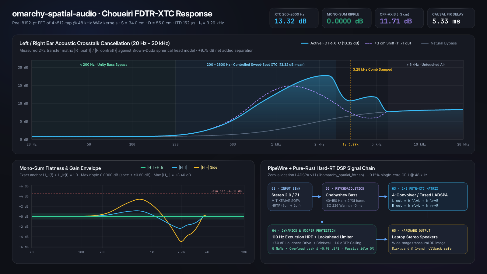
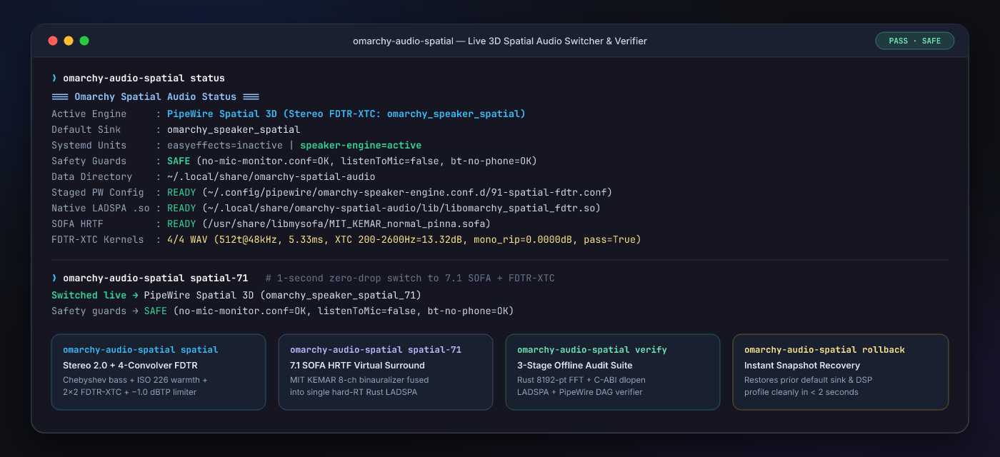

# omarchy-spatial-audio

A zero-dependency, pure-Rust **Choueiri Mono-Anchored FDTR Crosstalk Cancellation (XTC)** + **Psychoacoustic Missing-Fundamental Bass** + **7.1 Virtual Surround SOFA** PipeWire speaker DSP engine for laptop speakers on Linux.

Designed and acoustically verified for near-field top-firing laptop speakers (default geometry calibrated to Dell XPS 17 9720: `S = 34.0 cm`, `D = 55.0 cm`), with `--speaker-span-cm` and `--listening-distance-cm` flags to synthesize custom kernels for any laptop or desktop near-field setup.

<p align="center">
  
</p>

## Acoustic & DSP Highlights

- **Mono-Anchored Choueiri FDTR-XTC** — Variational frequency-dependent Tikhonov regularization anchored to exact unity mono-sum ($H_{ll}(f) + H_{lr}(f) = 1.0$):
  - **< 200 Hz:** Strict unity bypass — zero bass cancellation and zero wasted woofer excursion.
  - **200 – 2600 Hz:** Controlled **`13.32 dB`** mean cross-ear separation (`+9.75 dB` net added over natural head shadowing), retaining **`11.71 dB`** at `±3 cm` lateral head movement.
  - **2600 – 5500 Hz:** Smooth FDTR damping across the `3.29 kHz` comb-filter singularity ($f_1 = 1 / 2\tau$) — zero hollow vocal dips.
  - **> 6000 Hz:** Clean unity taper leaving tweeter air and upper harmonics untouched.
  - **0.000000 dB Mono-Sum Ripple** across `20 Hz – 20 kHz` (spec `≤ ±0.60 dB`) and **`+3.40 dB`** max side gain (spec `≤ +4.50 dB`).
- **Pure-Rust Hard-RT LADSPA v1.1 Plugin** (`libomarchy_spatial_fdtr.so`) — Zero heap allocations in `run()`, zero external crates (`std` only), combining dual-bank Chebyshev missing-fundamental bass (`40–150 Hz` → `2f/3f` harmonics), ISO 226:2023 warm body shelf, fused 2×2 FDTR-XTC, and lookahead true-peak limiting (`+7.0 dB` drive → `-1.0 dBTP` brickwall ceiling) in `~0.12%` of one CPU core at `48 kHz`.
- **Two Passive PipeWire Filter-Chain Sinks** (`0%` CPU when idle):
  - `omarchy_speaker_spatial` — Stereo 2.0 Warm·Rich + Parallel Chebyshev Bass + 4-convolver 2×2 FDTR-XTC + True-Peak Limiter.
  - `omarchy_speaker_spatial_71` — 7.1 Virtual Surround (`MIT_KEMAR_normal_pinna.sofa`) + Fused Rust LADSPA engine.
- **1-Second Live Switcher & Safety Guards** — `omarchy-audio-spatial` switches engines atomically under `flock`, enforces mic-monitor and Bluetooth profile guards (`no-mic-monitor.conf`, `listenToMic=false`, `bt-no-phone`), snapshots prior routing, and rolls back in `< 2 s` on failure.

<p align="center">
  
</p>

## Quick Install

### Prerequisites (Arch Linux / Omarchy)

```bash
sudo pacman -S --needed pipewire wireplumber libmysofa lsp-plugins-lv2 rust gcc python
```

### Build & Install

```bash
git clone https://github.com/akshaybapat6365/omarchy-spatial-audio.git
cd omarchy-spatial-audio
./install.sh
```

Customize for your laptop's physical speaker spacing and listening distance:

```bash
./install.sh --speaker-span-cm 30.0 --listening-distance-cm 50.0
```

Installer options:
- `--speaker-span-cm CM` — Distance between L/R speaker acoustic centers (default `34.0`)
- `--listening-distance-cm CM` — Desk listening distance (default `55.0`)
- `--target-sink NAME` — Physical PipeWire ALSA speaker sink (auto-detected via `pactl`)
- `--irs PATH` — Optional room/speaker EQ FIR (`.irs`/`.wav`); generates a flat unity impulse if omitted
- `--native` — Compile with `RUSTFLAGS="-C target-cpu=native"`

### Arch Linux (`PKGBUILD`)

```bash
makepkg -si
```

## Usage

```bash
omarchy-audio-spatial status        # Active engine, safety guards, staged kernels & metrics
omarchy-audio-spatial spatial       # Switch live to Stereo 2.0 + 2×2 FDTR-XTC
omarchy-audio-spatial spatial-71    # Switch live to 7.1 MIT KEMAR SOFA + Fused FDTR-XTC
omarchy-audio-spatial warm          # Switch back to EasyEffects Warm / default speaker profile
omarchy-audio-spatial rollback      # Instant pre-spatial routing snapshot restore (< 2 s)
omarchy-audio-spatial verify        # Full 3-stage offline Rust FFT + C-ABI LADSPA + PipeWire audit
```

### Standalone Offline DSP CLI

```bash
# Synthesize 4x 512-tap @ 48 kHz float32 WAV kernels
omarchy-spatial-dsp generate-kernels --out-dir ./kernels --speaker-span-cm 34.0 --listening-distance-cm 55.0

# Verify realized WAV kernels & real-time DSP throughput
omarchy-spatial-dsp verify --kernels-dir ./kernels

# Process a stereo WAV offline
omarchy-spatial-dsp process-wav --in track.wav --out track_spatial.wav --drive-db 7.0 --xtc-mix 1.0
```

## Uninstall

```bash
./uninstall.sh
```

## License

[MIT](LICENSE) © 2026 Akshay Bapat
